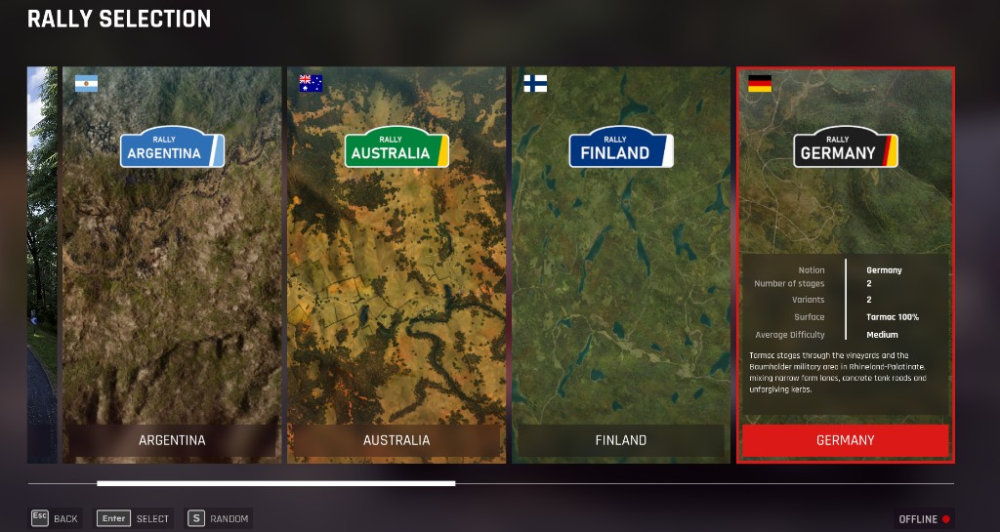
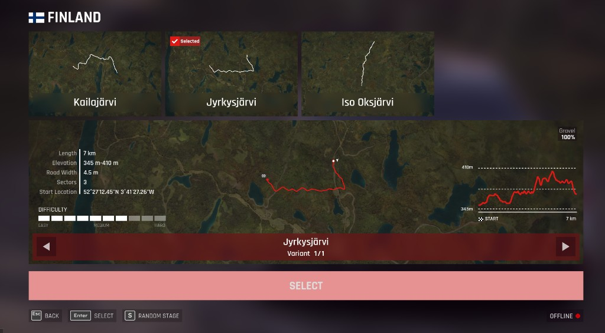
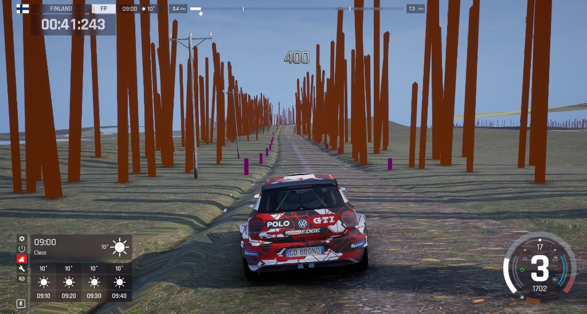

# ACR Extra Stages (beta)

> **Beta (0.1.0-beta.1, not yet released).** The generated stages build and pass the tool's
> offline checks, but in-game testing is still in progress. Expect rough edges, and please report
> problems (see [Reporting a problem](#reporting-a-problem)).

More rally stages for *Assetto Corsa Rally*. ACR Extra Stages takes stages from *DiRT Rally 2.0*
and builds them, **on your own PC and from your own game installs**, into extra stages that show
up in ACR's stage menus next to the built-in ones, with their own pace notes, menu maps and
height profiles.

> **Offline / single-player only.** The generated stages are for offline play. Do not use them
> in online, leaderboard or competitive modes (see [Disclaimer](#disclaimer)).

## Features

- 106 extra stages across 13 locations: Argentina, Australia, Finland, Monte Carlo, Germany,
  Greece, New Zealand, Poland, Scotland, Spain, Sweden, USA and Wales. The launcher starts with a
  recommended 30; Choose stages and type `all` for every stage that fits. The other 50 DiRT Rally
  2.0 stages are longer than 9 km and do not fit, so they cannot be built. New locations get their
  own entry, flag, description and tile in the stage menu.
- Pace notes for every stage, built on the game's own call vocabulary and distance calls.
- Generated route map, track map and height profile in the stage menus, and loading backdrops.
- Nothing is pre-made: the stage files are created locally from your own installs and never
  leave your PC.
- Nothing in the game's own files is modified. Everything goes into the `~mods` folder as
  separate `zz_acrxs_*` files, and the uninstaller removes exactly those.
- Every built stage is re-read and checked before installing.

## Requirements

- Windows 10 or 11, 64-bit.
- *Assetto Corsa Rally* installed through **Steam**. Early Access builds change often; stages are
  built against the game files you have, so a game update may need a rebuild (see
  [Known limitations](#known-limitations)).
- *DiRT Rally 2.0*, **your own copy** (Steam or another store). It is only read, never modified.
  The stages cannot be made without it.
- Disk space (estimates from the current build, to be confirmed for the release):
  - about **0.7 GB** of stage files per stage (about **20 GB** for the recommended 30, about
    **75 GB** for all 106 that fit),
  - plus about **15 GB** of free working space at the peak while the stages are generated
    (extracted DR2 data and intermediate files are removed stage by stage; what is left can be
    deleted afterwards). In total, about **38 GB free** for the recommended 30 and about **90 GB
    free** for all 106. The launcher states the number for whatever you have selected.
    `pwsh scripts\estimate-disk.ps1` prints the same estimate.
  - on the same NTFS drive as the game: the launcher reads the game's files and installs the
    stages through hard links instead of copies, so they take no extra space.
- An internet connection **once**, so a helper tool can fetch the Oodle compression library it
  needs (see [How it works](#how-it-works)). Generation and play are offline.

## Install

> No release zip has been published yet. Until then, build the stages from source (see
> [CONTRIBUTING.md](CONTRIBUTING.md)); the launcher below also runs from a source checkout
> ([tools/launcher/README.md](tools/launcher/README.md)).

1. Download `ACR-Extra-Stages-<version>.zip` from the
   [releases page](https://github.com/cherrymcgerry/acr-extrastages/releases) and extract it on
   **the same drive as the game**, in a folder with enough free space. Optionally check it against
   `SHA256SUMS.txt` from the same release: `Get-FileHash .\ACR-Extra-Stages-<version>.zip` in
   PowerShell.
2. Close the game and run **`AcrExtraStages.exe`**. It opens a console window with a menu.
3. The launcher finds your ACR and DiRT Rally 2.0 installs through Steam (or asks you to type the
   folder) and remembers them.
4. Optional: **Choose stages**. The recommended 30 are selected. Type `all` for every stage that
   fits (106), `default` to go back to the 30, or numbers, ranges (`5-8`) and a location name to
   switch individual stages. Stages marked "too long" are over 9 km and cannot be selected.
5. Choose **Install**. The launcher checks free disk space and that the game is closed, then:
   - creates the game's mappings file the first time (ACR starts briefly by itself and closes
     again; or point it to a Dumper-7 `.usmap`),
   - extracts the data it needs from your DiRT Rally 2.0 install,
   - builds and checks every stage (roughly a minute per stage on a fast PC, plus preparation),
   - puts the generated files into `<ACR>\acr\Content\Paks\~mods\` as `zz_acrxs_*` files.

   You can stop it at any time; the next run continues where it left off. A stage that fails is
   skipped and listed in `work\acr\batch\report.md`.
6. Start the game and look for the new stages in the stage menus (offline modes only).

After a game update or a new release, choose **Update**: only what changed is rebuilt.

The same steps run without the menu, for example `AcrExtraStages.exe install --yes`,
`AcrExtraStages.exe install --only AcrXsNz01r5` or `AcrExtraStages.exe uninstall`
(`AcrExtraStages.exe --help` lists every option).

## Uninstall

Use **Uninstall** in `AcrExtraStages.exe`, or delete every file starting with `zz_acrxs_` from
`<ACR>\acr\Content\Paks\~mods\`, where `<ACR>` is the game folder, usually
`...\Steam\steamapps\common\Assetto Corsa Rally`. Nothing else is changed. You can then delete
the launcher's working folder to get the disk space back.

If the game ever fails to start after an update, removing the `zz_acrxs_*` files restores the
unmodified game.

## How it works

ACR Extra Stages is a converter, not a stage pack. It reads the track data from *your* DiRT
Rally 2.0 install, builds ACR-format stage files and a menu registry from it, and writes them as
a standard `~mods` pak mod. To do this it uses a few open-source helper programs (listed in
[THIRD_PARTY_NOTICES.md](THIRD_PARTY_NOTICES.md)), which ship in the release zip next to the
launcher. The Oodle compression library that Unreal Engine games use is **not** part of this
project; it is fetched by one of the helper tools from its own source on your PC or supplied by
you, and is never redistributed here.

## Known limitations

- **Beta quality.** Stages are converted automatically, not hand-polished. Expect differences
  from the original game: ground and scenery detail, colliders, and pace-note timing.
- **Plainer ground on some stages.** About two thirds of the stages use stand-in ground
  textures rather than a baked copy of the DiRT ground, so they look plainer than the rest.
- **Heavy stages.** A few stages (for example Spain and Greece) have very large meshes and may
  run at a lower frame rate.
- **Pace notes are generated.** Corner calls may be later or earlier than in DiRT Rally 2.0, and
  distance calls follow the converted road.
- **Game updates.** An ACR update can change the files the stages are built against. If the
  stages stop appearing or the game fails to load them, remove them and rebuild with the latest
  release (see [docs/updating-after-a-patch.md](docs/updating-after-a-patch.md)).
- **Disk use.** The full set is large (see [Requirements](#requirements)).
- **Windows only**, and only the Steam release of ACR is tested.
- Stages are for **offline** play only.

## Troubleshooting

Common problems (disk space, Steam folders, the mappings step, antivirus, the same-drive
requirement, the Oodle download, failed stages, uninstall) are covered in
[docs/troubleshooting.md](docs/troubleshooting.md). After an ACR update, see
[docs/updating-after-a-patch.md](docs/updating-after-a-patch.md).

## Reporting a problem

Open an [issue on GitHub](https://github.com/cherrymcgerry/acr-extrastages/issues) and include
the stage (for example `AcrXsNz01r5`), the ACR build, what happened, and the launcher's log. Do
**not** attach game files or generated stage files.

## Disclaimer

ACR Extra Stages is an unofficial fan project. It is **not affiliated with or endorsed by
Electronic Arts, Codemasters, KUNOS Simulazioni, Supernova Games Studios, 505 Games, Valve, or
Nexus Mods**. "DiRT", "DiRT Rally", "Codemasters", "EA", "Assetto Corsa", "Assetto Corsa Rally",
"Steam" and all related names, locations and logos are trademarks or property of their
respective owners and are used here only to describe compatibility.

- This repository contains **no game content**: no tracks, textures, meshes, audio, mappings or
  game binaries. It contains only tools and settings that process files you already own.
- **Do not redistribute the generated stages (paks).** They contain material derived from
  *DiRT Rally 2.0* and *Assetto Corsa Rally*, which you do not have the right to share. Do not
  upload them to mod sites, file hosts or Discord, and do not include them in pull requests.
  Share the tool, not its output.
- Use it **offline only and at your own risk**. Do not use generated stages in online,
  leaderboard or competitive modes, and keep Steam offline while testing. Check the end-user
  license agreements of both games; modifying game files may not be allowed in some situations.
- The software is provided "as is", without warranty of any kind (see the licenses). The authors
  are not liable for damage to your game, saves, hardware or accounts.
- Nothing here is legal advice. If you are unsure whether something is permitted, ask the rights
  holders.

## License

Dual-licensed under either of [MIT](LICENSE-MIT) or [Apache-2.0](LICENSE-APACHE), at your
option. This covers the code and settings in this repository only, not any game content.
Third-party components and their licenses are listed in
[THIRD_PARTY_NOTICES.md](THIRD_PARTY_NOTICES.md).

## For developers

Building from source, the repository layout and the offline-only policy are in
[CONTRIBUTING.md](CONTRIBUTING.md). Other documents: [CHANGELOG.md](CHANGELOG.md),
[SECURITY.md](SECURITY.md) (reporting a security problem privately) and the maintainers'
[release checklist](docs/release-checklist.md).