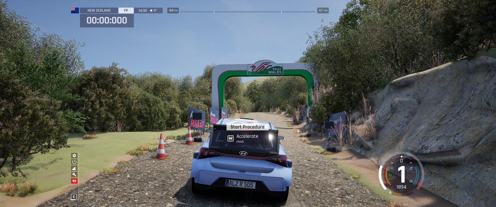

# ACR assets on ported stages (experimental)

By default a ported stage draws DR2's ground, road and objects into one render-only mesh, and leaves out vegetation.
These launcher options replace much of that with Assetto Corsa Rally's own assets. They are experimental and so far
tuned and checked in game on **New Zealand only** (`AcrXsNz01r5`, Te Awanga Sprint Reverse). Scotland rules exist in
`config/scenery.toml` but are untested in game; other locations get only what the shared rules match.

```bash
AcrExtraStages install --only AcrXsNz01r5 --native-props --acr-ground --acr-road
```

| Option | What it does |
|---|---|
| `--native-foliage` | DR2's trees, bushes and grasses become ACR's instanced foliage (spruces, birches, olives, maples, shrubs, high grass), sized to DR2 and kept off the road. |
| `--native-props` | Implies `--native-foliage`. DR2's fences, rocks, stumps, logs, tape poles, road markers, signs, start/finish gantries, timers, cones, banners and parked cars become ACR props from any ACR map; wild grass beside the road; steep banks get ACR's rock texture; no flat placeholder colours near the road. |
| `--acr-ground` | The DR2 ground colours get an ACR detail normal map (surface detail up close). |
| `--acr-road` | The road uses Hafren's layered 4K gravel material instead of DR2's road texture. |



Everything stays render-only: car collision is still DR2's (Kunos BakedData), so props do not change the driving line.

## How it works (short)

ACR assets are placed by reusing parts of Hafren South's persistent level that ACR hides during a stage (they carry the
`ServicePark` tag): its PCG stamp instanced components host foliage, fences, rocks and grass, and its service-park
static mesh actors host single props. Mapping rules (DR2 template name -> ACR mesh) live in `config/scenery.toml`
(`[native_foliage]`, `[native_props]`); materials in `config/visuals.toml`. Details, findings and pitfalls are in
`AGENTS.md`.

## Known limits

- The ground colour is still DR2's ground bake (about 14 cm per pixel); the ACR detail normal adds relief, not colour.
- Single props are placed at scale 1 and may face the wrong way (front and back of a mesh are not known).
- Hafren hosts are limited: about 280 single props per stage (nearest the road first) and 4 instanced prop meshes.
